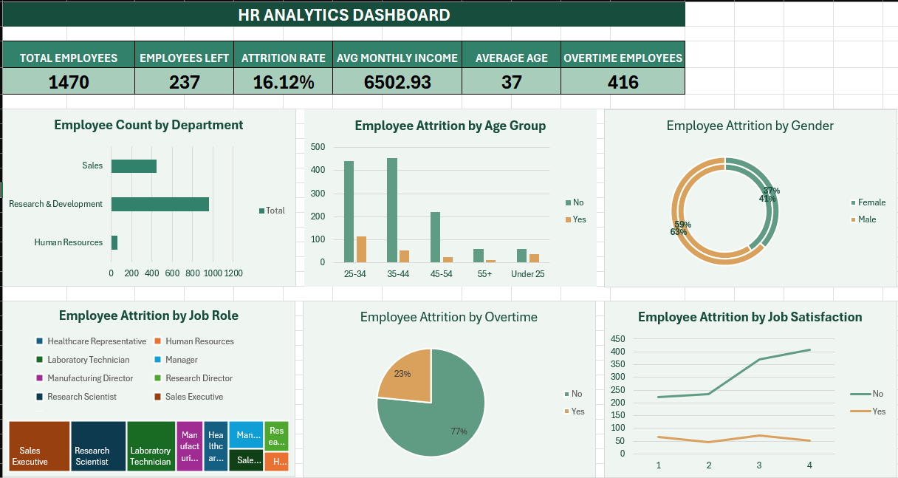

# HR Analytics Dashboard using Excel

## Project Overview
This project presents an HR Analytics Dashboard created using Microsoft Excel to analyze employee data and identify patterns related to employee attrition.

The dashboard provides a visual overview of employee demographics, department distribution, job roles, overtime, and job satisfaction.

## Tools Used
- Microsoft Excel
- PivotTables
- PivotCharts
- Excel formulas
- Data visualization

## Dashboard Preview

## Key Performance Indicators (KPIs)
- Total Employees
- Employees Left
- Attrition Rate
- Average Monthly Income
- Average Age
- Overtime Employees

## Visualizations
1. Employee Count by Department
2. Employee Attrition by Age Group
3. Employee Attrition by Gender
4. Employee Attrition by Job Role
5. Employee Attrition by Overtime
6. Employee Attrition by Job Satisfaction

## Key Insights
- The dataset contains 1,470 employees.
- A total of 237 employees left the organization.
- The overall employee attrition rate is approximately 16.12%.
- Average monthly income is approximately 6,502.93.
- The average employee age is approximately 37 years.
- A total of 416 employees work overtime.

## Objective
The objective of this project is to practice Excel-based data analysis and dashboard development, transform employee data into meaningful visualizations, and communicate HR insights effectively.

## Skills Demonstrated
- Data summarization
- PivotTable analysis
- KPI creation
- Dashboard design
- Data visualization
- Business insight communication

## Dataset
The project uses the IBM HR Analytics Employee Attrition & Performance dataset. The dataset is commonly available through Kaggle:

[IBM HR Analytics Employee Attrition & Performance Dataset](https://www.kaggle.com/datasets/pavansubhasht/ibm-hr-analytics-attrition-dataset)

## Author
Aspiring Data Analyst
